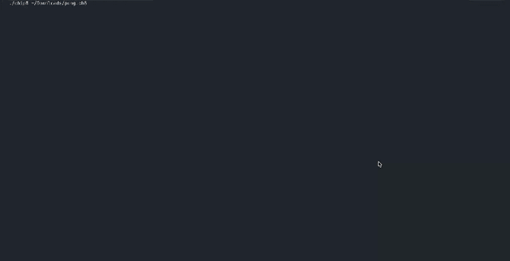
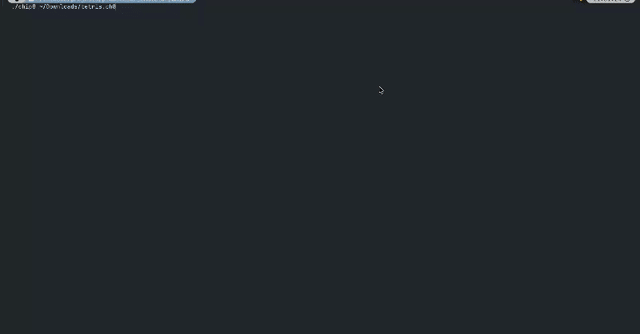

# CHIP-8 Emulator

[Русская версия](README.ru.md)

An educational CHIP-8 emulator written in C++17 with SDL2. The project is built
to study how a small virtual machine works: memory, registers, opcodes, the
fetch-decode-execute cycle, timers, keyboard input, and framebuffer rendering.

## What is CHIP-8?

CHIP-8 is a small interpreted programming language and virtual machine created
in the 1970s. Programs run on a simple specification with 4 KB of memory, a
64x32 monochrome display, sixteen registers, a hexadecimal keypad, timers, and
a compact instruction set. It is small enough to understand completely while
still demonstrating the core ideas behind an emulator.

## Demo

### Pong



[Open the original MP4 recording](assets/pong.mp4)

### Tetris



[Open the original MP4 recording](assets/tetris.mp4)

## Features

- 4 KB of CHIP-8 memory
- 16 8-bit general-purpose registers (`V0`-`VF`)
- Program counter, index register, stack, and stack pointer
- CHIP-8 opcode decoding and execution
- 64x32 monochrome framebuffer
- XOR sprite drawing with collision detection through `VF`
- Delay and sound timers
- SDL2 window rendering and keyboard input
- ROM loading from the command line
- Tested with Pong and Tetris ROMs

## Prerequisites

- A C++17-compatible compiler
- SDL2

## Build

The project was developed and tested on macOS with Apple Clang and SDL2.

Install SDL2 with Homebrew:

```bash
brew install sdl2
```

Build the emulator:

```bash
clang++ -std=c++17 main.cpp $(sdl2-config --cflags --libs) -o chip8
```

On another platform, use an equivalent C++17 compiler command and provide the
SDL2 compiler and linker flags for that system.

## Run

```bash
./chip8 path/to/game.ch8
```

ROM files are intentionally not included in this repository.

## Controls

The original 16-key CHIP-8 keypad is mapped to a QWERTY keyboard:

```text
1 2 3 4  ->  1 2 3 C
Q W E R  ->  4 5 6 D
A S D F  ->  7 8 9 E
Z X C V  ->  A 0 B F
```

## Architecture

The implementation is intentionally kept in one source file as a learning
exercise.

- `Chip8CPU` stores RAM, registers, the framebuffer, stack, timers, keypad
  state, and implements the fetch-decode-execute cycle.
- `Screen` converts the 64x32 framebuffer into an SDL2 texture and presents it
  in a scaled window.
- `LoadROM` reads a binary ROM into memory starting at address `0x200`.
- The main loop processes SDL events, executes nine CPU steps per frame, updates
  the timers, and redraws the framebuffer.

## Implemented instruction families

The emulator covers the core CHIP-8 instruction families for control flow,
register moves and arithmetic, bitwise operations, drawing, keyboard input,
timers, BCD conversion, and register-memory transfers.

## Tested ROMs

- Pong
- Tetris

## Compatibility and implementation assumptions

The current implementation targets the original CHIP-8 instruction set. SCHIP
and XO-CHIP extensions are not implemented.

- `FX55` and `FX65` leave `I` unchanged.
- `DXYN` wraps sprites around the horizontal and vertical screen edges.
- `8XY6` and `8XYE` shift `VX` in place and leave `VY` unchanged.
- The sound timer is tracked, but it is not connected to an audio device.
- The main loop executes nine CPU steps per frame; timing is intended for
  learning and gameplay, not cycle-accurate emulation.

## Limitations

This is an educational emulator, not a cycle-accurate implementation.

- The sound timer is implemented, but no audio output is produced yet.
- There is no automated opcode test suite yet.
- Timing and a few behaviours may differ between CHIP-8 interpreter variants.
- ROM files and copyrighted game assets are not distributed with the project.
- The current source layout favours readability and experimentation over a
  production-oriented multi-file architecture.

## Learning goals

This project is part of my study of computer architecture, binary instruction
formats, bitwise operations, memory addressing, virtual machines, and reverse
engineering.

## References

- [CHIP-8 Technical Reference](http://devernay.free.fr/hacks/chip8/C8TECH10.HTM)
- [CHIP-8 instruction set](https://github.com/mattmikolay/chip-8/wiki/CHIP%E2%80%908-Instruction-Set)
- [Gulrak's CHIP-8 test and reference materials](https://chip8.gulrak.net/)
- [CHIP-8 overview on Wikipedia](https://en.wikipedia.org/wiki/CHIP-8)

## License

No license has been selected yet.
